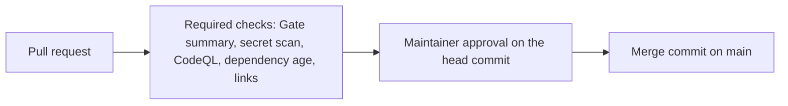

# Burnbird

Every CI minute in one place: GitHub-hosted, third-party and self-hosted runners, with a forecast of the day your free
minutes run out.

> [!NOTE]
> In development, not live yet. It will run at burnbird.racingcrow.com.

## What it does

- Counts the minutes of every GitHub Actions job, whichever runner ran it: GitHub-hosted, a third-party provider or
  your own self-hosted machine.
- Compares them with each provider's free allowance and forecasts the date it runs out, with a warning before it does.

## How it reads your data

You sign in with GitHub and install the Burnbird GitHub App on the accounts and repositories you choose. The App asks
for one permission, Actions: read, and GitHub adds read-only access to basic repository metadata (such as repository
names) to every App. Burnbird uses this to read the jobs of your workflow runs: their runner labels and their start
and end times. Actions: read would also allow reading job logs; Burnbird never reads or stores them. It has no
billing or administration access and cannot change anything.

We made the code public so you can check what Burnbird does with your data.

## How a change reaches main

## Development

Burnbird is not live yet, so there is nothing to run on its own. To install, test and lint, follow
[CONTRIBUTING.md](CONTRIBUTING.md), which also says how to start the throwaway Postgres and Mailpit the tests need.

## Contributing and security

We welcome issues and discussions: see [CONTRIBUTING.md](CONTRIBUTING.md). Report a vulnerability privately, as
[SECURITY.md](SECURITY.md) says.

## Licence

Fair Source (FSL-1.1-MIT): you can read, run and change the code for any purpose except offering a competing
commercial product or service; each version becomes MIT two years after release. See LICENSE.
